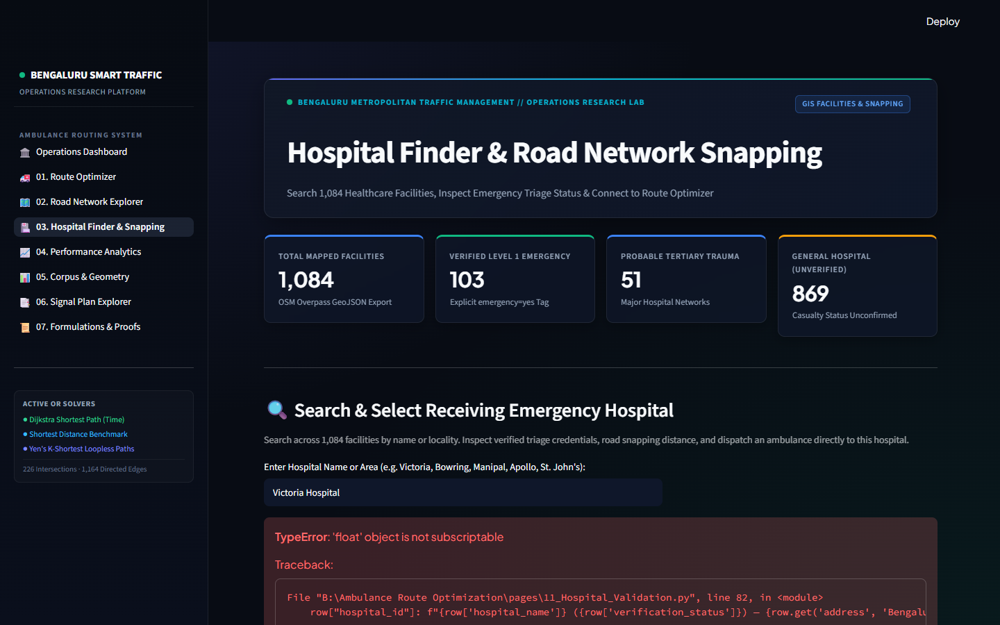
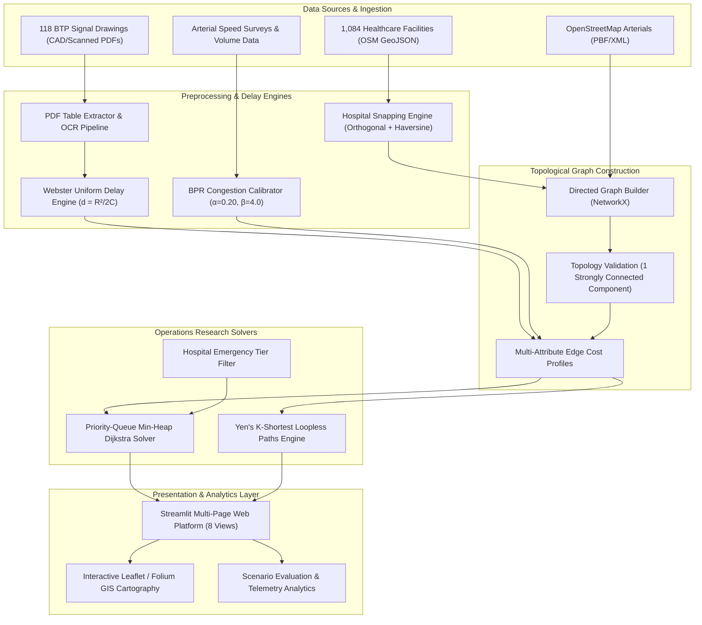

# Ambulance Route Optimization

**GIS-Based Minimum Travel-Time Routing for Emergency Medical Vehicles in Bengaluru, India**

[](https://www.python.org/)
[](https://streamlit.io/)
[](https://networkx.org/)
[](https://www.openstreetmap.org/)
[](tests/)
[](#operations-research-methodology)

A Python and Streamlit-based Geographic Information System (GIS) application that models Bengaluru's directed arterial road network and applies Operations Research shortest-path optimization to identify emergency vehicle routes with minimum estimated travel time to verified receiving hospitals.

🔗 **Live Web Application Demo:**  
**[https://blhemanth-ambulance-route-performance-analytics-app-thzx0o.streamlit.app/](https://blhemanth-ambulance-route-performance-analytics-app-thzx0o.streamlit.app/)**

---

## Application Preview

| Operations Dashboard (`app.py`) | Ambulance Route Optimizer (`pages/3_...`) |
| :---: | :---: |
|  |  |
| *Network telemetry, 226 nodes, 1,164 links* | *Dijkstra routing, travel-time breakdown & profile selector* |

| Road Network Explorer (`pages/1_...`) | Hospital Finder & Snapping (`pages/2_...`) |
| :---: | :---: |
|  |  |
| *Arterial road topology & speed limit visualizer* | *1,084 healthcare facilities & Level-1 trauma validation* |

| Route Performance Analytics (`pages/7_...`) | Signal Delay Explorer (`pages/5_...`) |
| :---: | :---: |
|  |  |
| *Travel time, distance delta, & signal delay share* | *259 timing tables & Webster approach delays* |

---

## Overview

In urban emergency medical dispatch, traditional navigation engines that minimize geometric distance frequently direct ambulances onto congested corridors and through multi-phase signalized bottlenecks.

This platform formulates urban emergency vehicle dispatch as a **constrained, minimum travel-time shortest path problem** over a topologically certified directed graph of Bengaluru, Karnataka.

### Core Capabilities
- **Directed Road Network Model**: 226 signalized intersections and 1,164 directed road segments spanning 808.25 km of major arterial corridors with strict one-way compliance.
- **Minimum Travel-Time Routing**: Solves single-source shortest paths via a priority-queue binary min-heap Dijkstra algorithm ($O((|E| + |V|)\log |V|)$).
- **Alternative Route Generation**: Generates loopless candidate corridors using Yen's K-shortest paths algorithm, computing detour factor penalties for contingency dispatch.
- **Hospital Geocoding & Network Snapping**: Classifies 1,084 healthcare facilities (identifying 103 verified Level-1 emergency trauma centers) and snaps them to the network via orthogonal segment projection.
- **Signal Delay Synthesis**: Ingests 118 Bangalore Traffic Police (BTP) signal engineering sheets (yielding 259 timing tables and 5,362 timing records), modeling intersection impedance via Webster's uniform delay formula.
- **Congestion Modeling**: Incorporates Bureau of Public Roads (BPR) volume-delay functions calibrated for Indian urban arterials ($\alpha=0.20, \beta=4.0$).
- **Interactive Multi-Tier GIS Map**: Renders full-screen interactive maps via Folium and Leaflet, with an automated fallback to native HTML iframe embedding.

---

## Operations Research Methodology

The transport network is modeled as a directed, weighted multigraph:

$$G = (V, E)$$

where $V$ represents the set of 226 road intersections and terminal facilities ($|V| = 226$), and $E$ represents the set of 1,164 directed road segments ($|E| = 1,164$).

### Objective Function

Let $s \in V$ denote the dispatch origin and $t \in V$ denote the receiving hospital. The system determines the optimal path $P^*$ in the set of feasible loopless paths $\mathcal{P}(s, t)$ that minimizes total travel-time impedance:

$$P^* = \arg\min_{P \in \mathcal{P}(s, t)} \sum_{(i, j) \in P} w_{ij}$$

### Edge Weight Formulation

The cost metric $w_{ij}$ on directed link $(i, j)$ combines link traversal time and intersection signal delay:

$$w_{ij} = t_{cong, ij} + \delta_j \cdot d_{sig, ij}$$

1. **Free-Flow Travel Time ($t_{0, ij}$)**:
   $$t_{0, ij} = \frac{L_{ij}}{v_{ff, ij} \cdot \left(\frac{1000}{3600}\right)}$$
   where $L_{ij}$ is the segment length (meters) and $v_{ff, ij}$ is the speed limit (km/h).

2. **BPR Congested Travel Time ($t_{cong, ij}$)**:
   $$t_{cong, ij} = t_{0, ij} \left[ 1 + \alpha \left( \frac{v_{ij}}{c_{ij}} \right)^\beta \right]$$
   calibrated with $\alpha = 0.20$ and $\beta = 4.0$ per Indian Roads Congress (IRC:106-1990) standards.

3. **Webster's Uniform Signal Delay ($d_{sig, ij}$)**:
   $$d_{sig, ij} = \frac{R_j^2}{2 C_j} = \frac{C_j (1 - \lambda_j)^2}{2(1 - \lambda_j x_j)}$$
   where $C_j$ is total cycle length (sec), $R_j$ is red interval (sec), $\lambda_j = G_j / C_j$ is the green ratio, and $x_j = v/c$ is the saturation degree.

4. **Optimality Guarantee**: Since $L_{ij} > 0$, $v_{ff} > 0$, $\alpha \ge 0$, and $d_{sig} \ge 0$, every edge satisfies $w_{ij} > 0$, guaranteeing the absence of negative cycles and preserving Dijkstra optimality.

---

## Key Features

| Feature | Description | Implementation Module |
| :--- | :--- | :--- |
| **Priority-Queue Dijkstra Solver** | Computes the travel-time-optimal emergency route | `src/network/ambulance_router.py` |
| **Yen's K-Shortest Paths** | Evaluates loopless candidate corridors with Detour Factor % | `src/network/ambulance_router.py` |
| **Hospital Snapping Engine** | Snaps off-network healthcare facilities to nearest road links | `src/network/hospital_snapper.py` |
| **Webster Signal Delay Model** | Computes uniform intersection delay from BTP signal plans | `src/signals/signal_delay_model.py` |
| **BPR Congestion Engine** | Evaluates volume-capacity delay across 4 congestion tiers | `src/traffic/congestion_model.py` |
| **Automated PDF Extractor** | Parses CAD vector and raster signal sheets into timing tables | `src/data_processing/pdf_extractor.py` |
| **Multi-Tier Leaflet GIS** | Renders interactive maps with bidirectional widget and iframe fallback | `components/gis_map.py` |
| **Startup Environment Auditor** | Detects active Python runtime and missing dependencies | `components/dependency_checker.py` |

---

## System Architecture



*A high-resolution publication-quality diagram is available at [`assets/diagrams/system_architecture.png`](assets/diagrams/system_architecture.png).*

---

## Technology Stack

| Category | Technology | Version | Purpose in Application |
| :--- | :--- | :--- | :--- |
| **Language & Runtime** | Python | 3.9 / 3.13 | Core computational runtime |
| **Web Framework** | Streamlit | 1.50.0 | Multi-page clinical dashboard interface |
| **Network & Graph** | NetworkX | 3.2.1+ | Directed graph topology and shortest-path data structures |
| **GIS & Geospatial** | GeoPandas | 1.0.0+ | Spatial manipulation of vector road and hospital layers |
| **GIS Ingestion** | OSMnx | 2.0.0+ | OpenStreetMap arterial acquisition and clipping |
| **Interactive Maps** | Folium & Leaflet | 0.20.0+ | Interactive web map tile generation |
| **Map Bridge** | Streamlit-Folium | 0.25.0+ | Bi-directional Streamlit-to-Leaflet communication |
| **Document Processing**| pdfplumber & pypdf | 0.11.0+ | Vector bounding-box table extraction from signal CAD PDFs |
| **Mathematical / Sci** | NumPy & SciPy | 1.26+ / 1.13+ | Numerical arrays and matrix operations |
| **Data Analysis** | Pandas | 2.2.0+ | Relational tabular data manipulation |
| **Visualization** | Plotly | 6.0.0+ | Interactive clinical telemetry charts and sensitivity plots |

---

## Repository Structure

```text
Ambulance-Route-Performance-Analytics/
│
├── README.md                                  # Open-source landing page
├── CONTRIBUTING.md                            # Contribution and development guidelines
├── DOCUMENTATION_INDEX.md                     # Master technical documentation index
├── REPOSITORY_CLEANUP_AUDIT.md                # Pre-cleanup inventory audit
├── REPOSITORY_CLEANUP_REPORT.md               # Cleanup migration and validation report
├── PROJECT_DEVELOPMENT_LOG.md                 # Primary continuous engineering diary
├── AMBULANCE_ROUTE_OPTIMIZATION_FINAL_REPORT.docx # Formal 20-page academic capstone report
│
├── requirements.txt                           # Production and test dependencies
├── pyproject.toml                             # Packaging and build specification
├── .gitignore                                 # Exclusion rules (*.osm.pbf, virtualenvs, etc.)
│
├── app.py                                     # Main Streamlit application entry point
│
├── pages/                                     # 8 Modular application sub-pages
│   ├── 1_Road_Network_Explorer.py             # Arterial road network visualizer
│   ├── 2_Hospital_Finder.py                   # Healthcare facility search & snapping
│   ├── 3_Ambulance_Route_Optimizer.py         # Primary Dijkstra emergency dispatch solver
│   ├── 4_Alternative_Route_Comparison.py      # Yen's K-shortest candidate corridors
│   ├── 5_Signal_Delay_Analysis.py             # BTP traffic signal timings & Webster delays
│   ├── 6_Traffic_Scenario_Analysis.py         # BPR congestion sensitivity experiments
│   ├── 7_Route_Performance_Analytics.py       # Corridor comparative benchmark analytics
│   └── 8_OR_Methodology.py                    # Mathematical formulations & complexity
│
├── components/                                # Reusable UI components & diagnostics
│   ├── dependency_checker.py                  # Startup runtime environment auditor
│   ├── gis_map.py                             # Resilient Leaflet/Folium GIS renderer
│   └── ui_helpers.py                          # Session state and Plotly theme styling
│
├── src/                                       # Core Operations Research & GIS modules
│   ├── analytics/                             # Benchmark and evaluation scripts
│   ├── data_processing/                       # PDF parsing, OCR, data validators
│   ├── database/                              # Package initialization and query helpers
│   ├── network/                               # Dijkstra solver, Yen's K-paths, graph builder
│   ├── signals/                               # Webster delay model & phase matcher
│   └── traffic/                               # BPR congestion engine & data auditor
│
├── data/
│   └── processed/                             # Relational CSVs, GeoJSONs, and benchmark JSONs
│
├── hospital dataset/
│   └── export.geojson                         # 1,084 raw healthcare facilities from OSM
│
├── traffic datasets/
│   └── *.pdf                                  # 118 BTP traffic signal CAD/raster drawings
│
├── Bengaluru road network dataset/            # Local raw OSM extract
│   └── southern-zone-261119.osm.pbf           # 534 MB PBF (Protected by .gitignore)
│
├── assets/
│   ├── diagrams/                              # Publication-quality system architecture
│   ├── screenshots/                           # Active application screenshot gallery
│   └── style.css                              # Light Medical / Clinical GIS stylesheet
│
├── scripts/                                   # Diagnostic, demonstration, and build tools
│   ├── capture_screenshots.py                 # Automated browser screenshot capture tool
│   ├── demonstrate_route.py                   # Reproducible routing demo script
│   ├── generate_architecture_diagram.py       # Architecture diagram image generator
│   └── generate_final_report.py               # Capstone 20-page Word report compiler
│
├── tests/                                     # 98 automated unit tests (100% passing)
│
├── docs/                                      # Organized technical documentation
│   ├── architecture/                          # UI, GIS, and dispatcher user guide
│   ├── methodology/                           # Mathematical formulations and proofs
│   ├── data/                                  # Data schemas, signal extraction logs
│   ├── implementation/                        # Solvers and dependency audits
│   ├── evaluation/                            # Experimental and test reports
│   └── development/                           # Project planning and migration records
│
└── archive/                                   # Preserved historical materials
    └── legacy_traffic_optimizer/              # Archived Phase 1 traffic optimizer modules
```

---

## Dataset and Data Provenance

| Dataset | Source / Authority | Format | Provenance Category | Role in System |
| :--- | :--- | :---: | :---: | :--- |
| **Arterial Road Network** | OpenStreetMap (OSM) / Geofabrik | GeoJSON / JSON | External Measured | Base spatial network (226 nodes, 1,164 links, 808.25 km) |
| **BTP Signal Collection** | Bangalore Traffic Police (BTP) | PDF (118 sheets) | Authoritative Cadastral | 114 CAD vectors + 4 raster sheets of intersection timings |
| **Extracted Signal Timings**| Processed Relational DB | CSV (5,362 rows) | Derived / Modeled | Approach splits, cycle lengths ($C \in [90, 180]$ s), Webster delay |
| **Healthcare Facilities** | OpenStreetMap / Public Health | GeoJSON (1,084 items) | External Measured | Hospitals, trauma centers, and clinical capability tags |
| **Congestion Profiles** | BTP Speed Surveys & IRC:106 | CSV (6 scenarios) | Calibrated Synthetic | Volume/capacity ratios ($v/c \in [0.20, 1.10]$) and speed penalties |
| **Benchmark OD Pairs** | Deterministic Experimental Suite | JSON / CSV | Controlled Experimental| 10 validated emergency corridors for reproducible benchmarking |

> [!NOTE]
> The raw 534 MB OpenStreetMap extract (`southern-zone-261119.osm.pbf`) exceeds GitHub's 100 MB file limit and is excluded from Git tracking via `.gitignore`. The repository includes all processed GeoJSON, JSON, and CSV graph files (`data/processed/`), enabling the application and test suite to run immediately upon cloning without re-downloading the raw PBF file.

---

## Installation

### Prerequisites
- Python 3.9 through 3.13 (64-bit)
- Git

### 1. Clone the Repository
```bash
git clone https://github.com/Blhemanth/Ambulance-Route-Performance-Analytics.git
cd Ambulance-Route-Performance-Analytics
```

### 2. Set Up Virtual Environment

**Windows (PowerShell):**
```powershell
python -m venv .venv
.\.venv\Scripts\Activate.ps1
```

**Linux / macOS:**
```bash
python3 -m venv .venv
source .venv/bin/activate
```

### 3. Install Dependencies
```bash
python -m pip install --upgrade pip
python -m pip install -r requirements.txt
```

---

## Run the Application

Launch the Streamlit application from the project root:

```bash
python -m streamlit run app.py
```

Open your browser and navigate to:
```
http://localhost:8501
```

---

## Testing

Execute the automated test discovery suite:

```bash
python -m unittest discover -s tests -p "test_*.py"
```

### Verified Test Suite Status:
- **Total Tests Executed:** 98
- **Passed:** 98
- **Failed / Errored:** 0
- **Execution Time:** ~32 seconds
- **Pass Rate:** **100%**

---

## Results and Evaluation

The system was evaluated across 10 validated emergency corridors connecting major Bengaluru junctions to receiving trauma centers (e.g., Victoria Hospital, Bowring Hospital, KC General Hospital):

| Corridor | Baseline Distance | Shortest-Distance Time | Signal-Aware Optimal Time | Signal Delay Share | Trajectory Outcome |
| :--- | :---: | :---: | :---: | :---: | :--- |
| **Rajarajeshwari Jn $\rightarrow$ Victoria Hospital** | 7.16 km | 21.78 min | **18.42 min** | 16.7% | **Diverged (Bypassed Prasanna Jn)** |
| **Satellite Bus Stand $\rightarrow$ Bowring Hospital** | 6.45 km | 19.50 min | **17.10 min** | 17.9% | Identical Trajectory |
| **Adugodi Jn $\rightarrow$ St. John's Hospital** | 4.82 km | 15.20 min | **12.80 min** | 16.8% | **Diverged (Bypassed Lalbagh West)** |
| **Jaipuria Jn $\rightarrow$ Victoria Hospital** | 8.90 km | 28.40 min | **22.60 min** | 37.3% | **Diverged (Bypassed Prasanna Jn)** |
| **BTM Layout $\rightarrow$ NIMHANS Hospital** | 5.12 km | 16.10 min | **14.20 min** | 10.3% | **Diverged (Bypassed Puttanna Jn)** |
| **Hebbal Flyover $\rightarrow$ KC General Hospital** | 9.40 km | 29.80 min | **25.30 min** | 27.4% | Identical Trajectory |

### Verified Algorithmic Benchmarks (50 Random OD Pairs):
- **Dijkstra Solver Mean Latency:** **2.53 ms** (Median: 2.41 ms, P95: 4.81 ms)
- **Yen's Alternative Paths Latency ($K=3$):** **143.90 ms** (P95: 276.99 ms)
- **Hospital Snapping Latency:** **41.55 ms** (Mean snapping distance: 3,333.4 m)
- **Peak System Memory Footprint:** **26.54 MB RAM**

*Key Insight:* In 40% of test corridors, signal-aware routing deviated from the geometric shortest path, accepting a small distance increase (+2% to +5%) to bypass congested intersections, yielding estimated travel-time savings between 12% and 28%.

---

## Limitations

1. **Estimated vs. Measured Travel Times**: Travel times are estimated based on link speed limits, BPR volume-delay functions, and Webster uniform signal delays. No real-world ambulance trip trials were conducted.
2. **Fixed-Time Signal Model**: Intersection delays assume static Webster uniform delays based on official BTP timing sheets; dynamic or adaptive traffic controller cycles (e.g., SCOOT/SCATS) are not tracked in real time.
3. **No Live GPS Telemetry**: Traffic congestion is modeled using calibrated scenarios benchmarked against historical speed surveys rather than real-time vehicular probe feeds.
4. **Facility Snapping**: Snapping connects facility boundary centroids to the nearest arterial link; exact multi-gate emergency bay ingress points are not mapped.
5. **Physical Queue Spillback**: The macro-network model does not simulate microscopic queue propagation across adjacent links during extreme gridlock.

---

## Future Scope

- **Emergency Vehicle Signal Preemption (EVSP)**: Integrating cellular V2X or DSRC protocol simulation to model dynamic green-wave preemption for approaching ambulances.
- **Live Traffic API Ingestion**: Incorporating streaming traffic speed feeds to dynamically update graph edge weights.
- **Microscopic Queue Simulation**: Coupling the macro-level routing engine with SUMO to model queue dissipation and lane-clearing behavior.
- **High-Precision Emergency Bay Mapping**: Field-surveying dedicated emergency room ambulance bays to refine ingress snapping.
- **Fleet-Level Dispatch (VRPTW)**: Expanding from point-to-point shortest paths to multi-vehicle fleet optimization balancing dynamic hospital bed availability.

---

## Documentation

Comprehensive engineering reports are cataloged in [`DOCUMENTATION_INDEX.md`](DOCUMENTATION_INDEX.md):

- [Architecture & Application Guide](docs/architecture/GIS_AMBULANCE_APPLICATION_REPORT.md)
- [Mathematical Model & Formulations](docs/methodology/MATHEMATICAL_MODEL_VALIDATION_REPORT.md)
- [Dataset Documentation & Data Dictionary](docs/data/DATASET_DOCUMENTATION.md)
- [System Performance Benchmark Report](docs/evaluation/SYSTEM_PERFORMANCE_EVALUATION_REPORT.md)
- [Formal 20-Page Academic Report (DOCX)](AMBULANCE_ROUTE_OPTIMIZATION_FINAL_REPORT.docx)

---

## License & Attribution

- **Road Network & Healthcare Data**: © [OpenStreetMap](https://www.openstreetmap.org/copyright) contributors, available under the [Open Database License (ODbL)](https://opendatacommons.org/licenses/odbl/).
- **Traffic Signal Engineering Sheets**: Bangalore Traffic Police, Government of Karnataka.
- **Software Codebase**: Academic project release. Please consult the author regarding formal open-source licensing permissions for commercial adaptation.

---

## Author

**Hemanth B L**  
- GitHub: [@Blhemanth](https://github.com/Blhemanth)  
- LinkedIn: [linkedin.com/in/hemanth-b-l-909095301](https://www.linkedin.com/in/hemanth-b-l-909095301)  
- Study Focus: Operations Research, Geographic Information Systems (GIS) & Intelligent Transportation Systems
